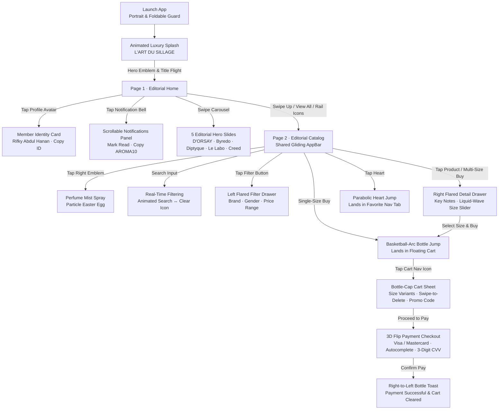
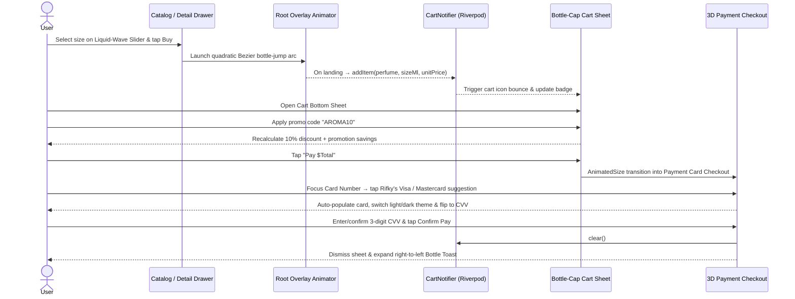
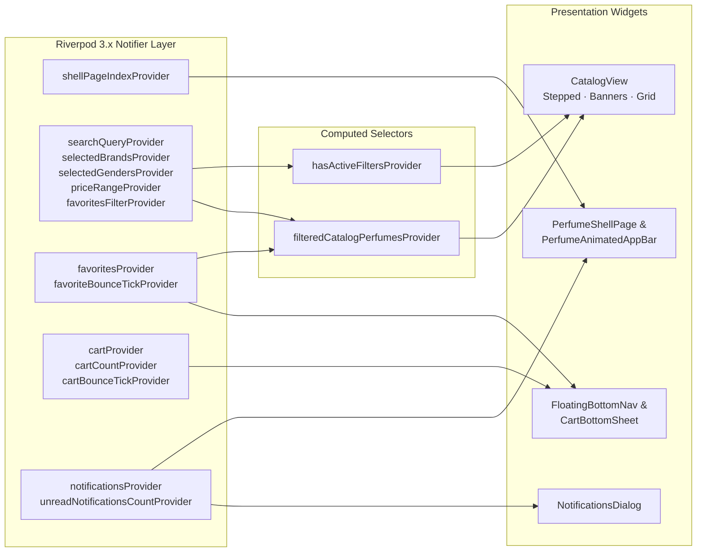

<div align="center">


# A R O M A N T I Q U E

**L'ART DU SILLAGE** · *Luxury Niche Fragrance Boutique built with Flutter*

<br/>


<br/>

<table>
  <tr>
    <td width="50%">
      
    </td>
    <td width="50%">
      
    </td>
  </tr>
</table>

*Minimalist Parisian fragrance boutique experience crafted with bespoke Canvas painters, fluid liquid physics, dynamic bottle-tone extraction, and 60/120fps micro-interactions.*

</div>

---

## Table of Contents

1. [Overview](#overview)
2. [Design System & Visual Identity](#design-system--visual-identity)
3. [Application Flow & User Journey](#application-flow--user-journey)
4. [Cart & 3D Payment Checkout Flow](#cart--3d-payment-checkout-flow)
5. [State Management Architecture](#state-management-architecture)
6. [Signature Features & Craftsmanship](#signature-features--craftsmanship)
7. [Project Structure](#project-structure)
8. [Catalog & Demo Credentials](#catalog--demo-credentials)
9. [Getting Started & Verification](#getting-started--verification)
10. [Credits & Acknowledgments](#credits--acknowledgments)
11. [License](#license)

---

## Overview

**Aromantique** is a high-craft luxury perfume e-commerce mobile application engineered in **Flutter** using **Feature-First Architecture** and **Riverpod 3.x** (`NotifierProvider`). Rather than relying on generic UI templates, every surface—from the peaked AppBar and asymmetrical stepped product cards to the custom liquid-wave bottle size slider and 3D-flipping payment card—is purpose-built to evoke the tactile elegance of Parisian niche perfumery houses (*Louis Vuitton, Byredo, Diptyque, Le Labo, Creed, D'ORSAY, Dior,* and *Tom Ford*).

---

## Design System & Visual Identity

All colors and typography are strictly centralized in [`lib/core/theme/app_colors.dart`](lib/core/theme/app_colors.dart) and [`lib/core/theme/app_theme.dart`](lib/core/theme/app_theme.dart) with zero hardcoded UI hex values.

### Color Palette

| Token | Hex | Role |
| :--- | :--- | :--- |
| `AppColors.background` | `#F3F6F7` | Cool alabaster mist scaffold canvas |
| `AppColors.surface` | `#FFFFFF` | Pure crisp card & modal surfaces |
| `AppColors.inkPrimary` | `#121518` | Obsidian editorial typography & primary CTAs |
| `AppColors.inkSecondary` | `#6B7278` | Muted slate secondary copy |
| `AppColors.sageHighlight` | `#D9E4E5` | Soft mist-sage accents, pills & liquid highlights |
| `AppColors.sageIcon` | `#5D7276` | Refined botanical slate-sage icons & labels |
| `AppColors.borderSubtle` | `#E3E8EA` | Hairline architectural borders |
| `AppColors.notificationDot` | `#E53935` | Unread alert & favorite heart accent |

### Typography

| Role | Font Family | Usage |
| :--- | :--- | :--- |
| **Brand & Editorial Display** | `BricolageGrotesque` (200–800) | Wordmark, hero headlines, section titles, member name, stamps |
| **Interface & Content** | `CabinetGrotesk` (100–900) | Product names, notes, pricing, ruler ticks, checkout inputs |

---

## Application Flow & User Journey



---

## Cart & 3D Payment Checkout Flow



---

## State Management Architecture



---

## Signature Features & Craftsmanship

### 1. Splash, Shared Gliding AppBar & Orientation Guard
- **Luxury Splash (`splash_page.dart`)**: Staggered reveal of the custom-painted `AromatiqueEmblem` and `"L'ART DU SILLAGE"` tagline, transitioning seamlessly via `Hero` flight (`aromatique-emblem`, `aromatique-title`) directly into the Home AppBar.
- **Shared Gliding AppBar (`perfume_animated_app_bar.dart` & `custom_shaped_app_bar.dart`)**: Custom curved silhouette with an upward center peak; `"Aromantique"` smoothly interpolates from left-aligned on Page 1 to centered on Page 2, while tapping the right emblem on Page 2 triggers a **34-particle perfume mist spray** animation.
- **Portrait & Foldable Guard (`portrait_guard.dart`)**: Enforces portrait presentation with tailored alerts for landscape orientation and unfolded wide-screen devices.

### 2. Editorial Home, Member Identity & Notifications
- **Editorial Home (`editorial_home_view.dart`)**: Asymmetric vertical left navigation rail (`LeftSearchNotch`, rotated `View all`, perfume-bottle-shaped active nav highlight) paired with a full-bleed 5-slide editorial showcase (`editorial_hero_card.dart`).
- **Member Profile Dialog (`member_profile_dialog.dart`)**: Tapping the male editorial avatar opens a 60/120fps GPU-composited **Atelier Member** card displaying **Rifky Abdul Hanan** and tap-to-copy ID **`21552011052`**.
- **Scrollable Notifications (`notifications_dialog.dart`)**: 10 curated atelier notifications with real-time unread dot synchronization, individual mark-as-read, *"Mark all read"*, and one-tap promo code copy.

### 3. Varied Editorial Catalog & Dynamic Color Extraction
- **Anti-Monotony Feed Rhythm (`catalog_view.dart`)**: Alternates between signature asymmetrical **Stepped Cards** (`stepped_perfume_card.dart`), custom AI-generated **Promotional Banners** (`catalog_promo_banner.dart` — *Seasonal Archive 45% Off* & *Atelier Reserve AROMA10*), and **2-Column Grid Cards** (`grid_perfume_card.dart`), concluding with an **Archive Vault Out-of-Stock** item rendered in grayscale with a tilted `OUT OF STOCK` stamp.
- **Dynamic Bottle-Tone Extraction (`bottle_tone_extractor.dart`)**: Samples pixel colors directly from each `.webp` bottle asset to compute matching pastel card tints and realistic **2-o'clock tinted drop shadows** composited with `BlendMode.multiply`.

### 4. Fully Custom Liquid-Wave Bottle Size Slider
- **Continuous Custom Slider (`perfume_size_slider.dart`)**: Built from scratch with `CustomPainter` and `GestureDetector`:
  - 1:1 continuous finger tracking with smooth magnetic snapping (`Curves.easeInOutCubic`).
  - **Left-to-Right Flowing Water Wave**: Leading translucent surge, dual rolling horizontal wave bands, and drifting micro-bubbles that decay smoothly to zero with **zero blink**.
  - **Synchronized Mini Bottles**: Progressive bottle silhouettes aligned directly above each ruler stop whose internal liquid levels fill in real time as the water wave arrives at each mark.

### 5. Bottle-Cap Cart & 3D-Flipping Payment Checkout
- **Bottle-Cap Bottom Sheet (`cart_bottom_sheet.dart`)**: Custom curved bottle-cap header silhouette, variant-aware cart items (`perfume.id + selectedSizeMl`), quantity stepper, swipe-to-delete, promotion savings breakdown, and bottle-styled promo input (`AROMA10`).
- **Interactive 3D Payment Card (`payment_card_checkout.dart`)**: Live Visa (light silver-blue) and Mastercard (dark obsidian-teal) 3D Y-axis flip animation with geometric hex/particle texture, embossed EMV chip, cardholder autocomplete dropdown, 3-digit CVV validation, and right-to-left expanding **Bottle Toast** confirmation (`bottle_toast.dart`).

---

## Project Structure

```text
aromantique/
├── docs/
│   └── aromantique_logo.svg                  # Vector brand emblem for documentation
├── assets/
│   ├── fonts/
│   │   ├── bricolage_grotesque/              # Brand & display font family (200–800)
│   │   └── cabinet_grotesk/                  # UI & content font family (100–900)
│   └── images/
│       ├── banners/                          # Theme-matched editorial promo banners
│       ├── bottles/                          # 12 luxury perfume bottle .webp assets
│       ├── payments/                         # Visa & Mastercard brand marks
│       ├── hero_slide_1..5.jpg               # 5 editorial hero slides
│       └── user_avatar.jpg                   # Male editorial member portrait
├── lib/
│   ├── main.dart                             # App entrypoint & ProviderScope
│   ├── core/
│   │   ├── theme/
│   │   │   ├── app_colors.dart               # Centralized color palette
│   │   │   └── app_theme.dart                # ThemeData & typography scale
│   │   ├── utils/
│   │   │   └── bottle_tone_extractor.dart    # Dynamic pastel & shadow color extractor
│   │   └── widgets/
│   │       ├── aromatique_emblem.dart        # Custom-painted ornate perfume emblem
│   │       ├── bottle_toast.dart             # Right-to-left expanding bottle alert toast
│   │       ├── circular_scent_badge.dart     # Rotating circular editorial stamp
│   │       ├── custom_shaped_app_bar.dart    # Curved AppBar with upward center peak
│   │       ├── empty_perfume_state.dart      # Empty search & sad-bottle cart states
│   │       ├── flared_side_drawer_container.dart
│   │       ├── perfume_bottle_nav_bg.dart    # Bottle-shaped active nav indicator
│   │       └── portrait_guard.dart           # Orientation & foldable layout guard
│   └── features/perfume/
│       ├── data/
│       │   └── perfume_mock_data.dart        # 5 hero slides, 12 in-stock + 1 OOS item
│       ├── domain/
│       │   └── perfume.dart                  # Perfume, PerfumeGender & CartItem models
│       └── presentation/
│           ├── pages/
│           │   ├── splash_page.dart
│           │   ├── perfume_shell_page.dart
│           │   ├── editorial_home_view.dart
│           │   └── catalog_view.dart
│           ├── providers/
│           │   └── perfume_providers.dart    # Riverpod 3.x state & derived selectors
│           └── widgets/
│               ├── cart_bottom_sheet.dart
│               ├── catalog_promo_banner.dart
│               ├── editorial_hero_card.dart
│               ├── floating_bottom_nav.dart
│               ├── grid_perfume_card.dart
│               ├── left_search_notch.dart
│               ├── member_profile_dialog.dart
│               ├── notifications_dialog.dart
│               ├── payment_card_checkout.dart
│               ├── perfume_animated_app_bar.dart
│               ├── perfume_bottle_placeholder.dart
│               ├── perfume_detail_drawer.dart
│               ├── perfume_filter_drawer.dart
│               ├── perfume_size_slider.dart
│               └── stepped_perfume_card.dart
└── test/
    └── widget_test.dart                      # End-to-end flow, landscape & foldable tests
```

---

## Catalog & Demo Credentials

| Category | Details |
| :--- | :--- |
| **Featured Maisons** | Louis Vuitton · Byredo · Diptyque · Le Labo · Creed · D'ORSAY · Dior · Tom Ford |
| **Promotional Badges** | `20% OFF` (Pacific Chill) · `45% OFF` (Tam Dao) · `Limited` (Imagination) · `New Arrival` (Afternoon Swim) |
| **Out-of-Stock Vault** | `Oud Wood` by Tom Ford (grayscale treatment + tilted `OUT OF STOCK` stamp) |
| **Checkout Promo Code** | `AROMA10` — applies an additional **10% off** subtotal |
| **Saved Demo Cards** | Tap the **Card Number** field during checkout to autofill saved Visa or Mastercard credentials |

---

## Getting Started & Verification

### Prerequisites
- **Flutter SDK** `3.47+` (using `material_ui ^1.1.0`)
- **Dart SDK** `^3.14.0`

### Installation & Run
```bash
# 1. Clone the repository
git clone https://github.com/rinansy/aromantique.git
cd aromantique

# 2. Install dependencies
flutter pub get

# 3. Run on a connected device or emulator
flutter run
```

### Static Analysis & Widget Tests
```bash
# Verify zero lints or warnings
flutter analyze

# Execute full widget test suite (end-to-end flow + orientation & foldable guards)
flutter test
```

---

## Credits & Acknowledgments

| Resource | Attribution |
| :--- | :--- |
| **Author & Lead Developer** | **Rifky Abdul Hanan** ([@rinansy](https://github.com/rinansy)) · `21552011052` |
| **UI Framework** | [Flutter](https://flutter.dev) & [Dart](https://dart.dev) |
| **State Management** | [Riverpod](https://riverpod.dev) (`flutter_riverpod ^3.5.0`) |
| **Iconography** | [Phosphor Icons](https://phosphoricons.com) (`phosphoricons_flutter ^1.1.1`) |
| **Typography** | **Bricolage Grotesque** (by Mathieu Triay, SIL OFL) & **Cabinet Grotesk** (by Indian Type Foundry) |
| **Brand References** | All fragrance house names (*Louis Vuitton, Byredo, Diptyque, Le Labo, Creed, D'ORSAY, Dior, Tom Ford*) and payment marks (*Visa, Mastercard*) are used strictly for educational & UI portfolio demonstration purposes and remain the property of their respective owners. |

---

## License

This project is licensed under the **MIT License** — see the [`LICENSE`](LICENSE) file for full details.

> You are welcome to copy, fork, or build upon this project, provided that the original copyright notice and credit to **Rifky Abdul Hanan ([@rinansy](https://github.com/rinansy))** are retained.

---

<div align="center">

### Atelier Member

**Rifky Abdul Hanan** · [@rinansy](https://github.com/rinansy) · `21552011052`

*Crafted with precision, fluid motion, and quiet luxury.*

</div>
